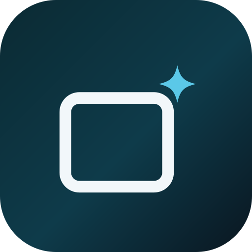
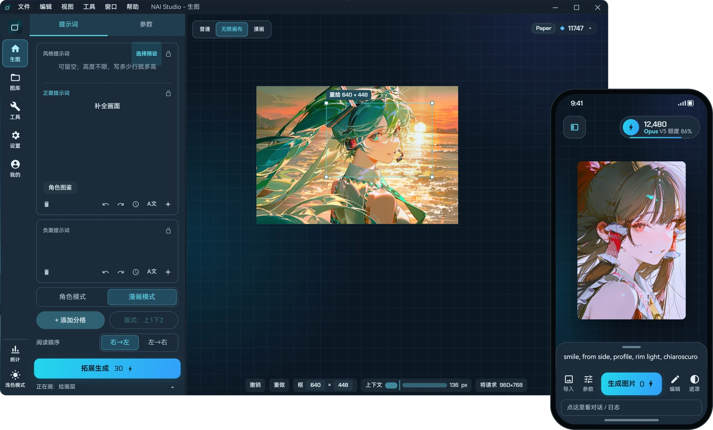
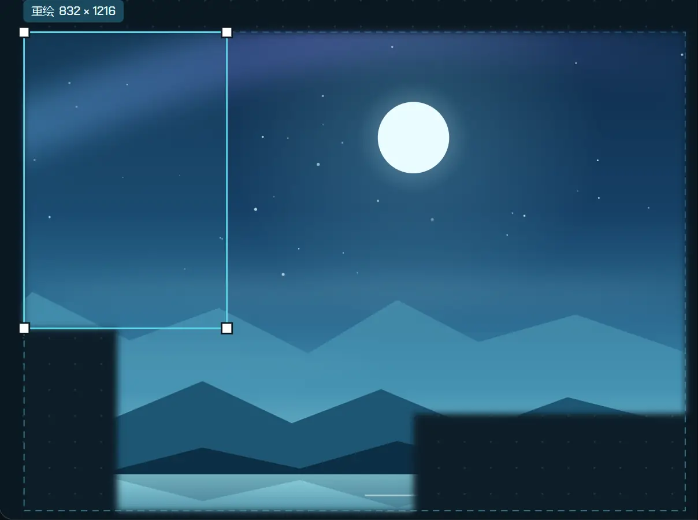
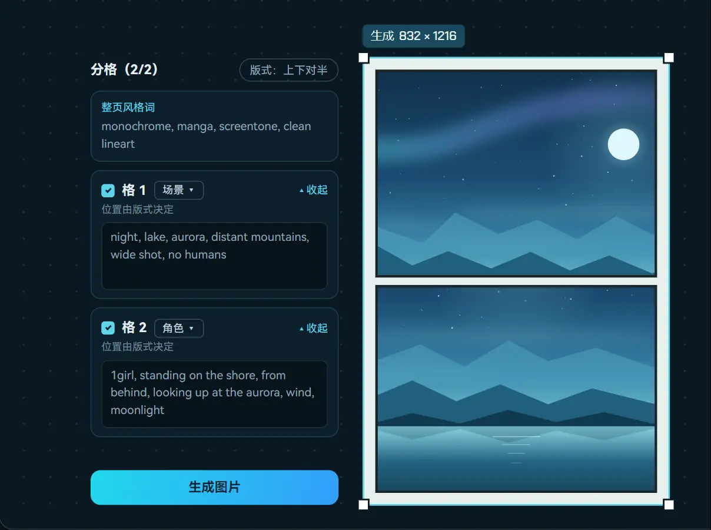
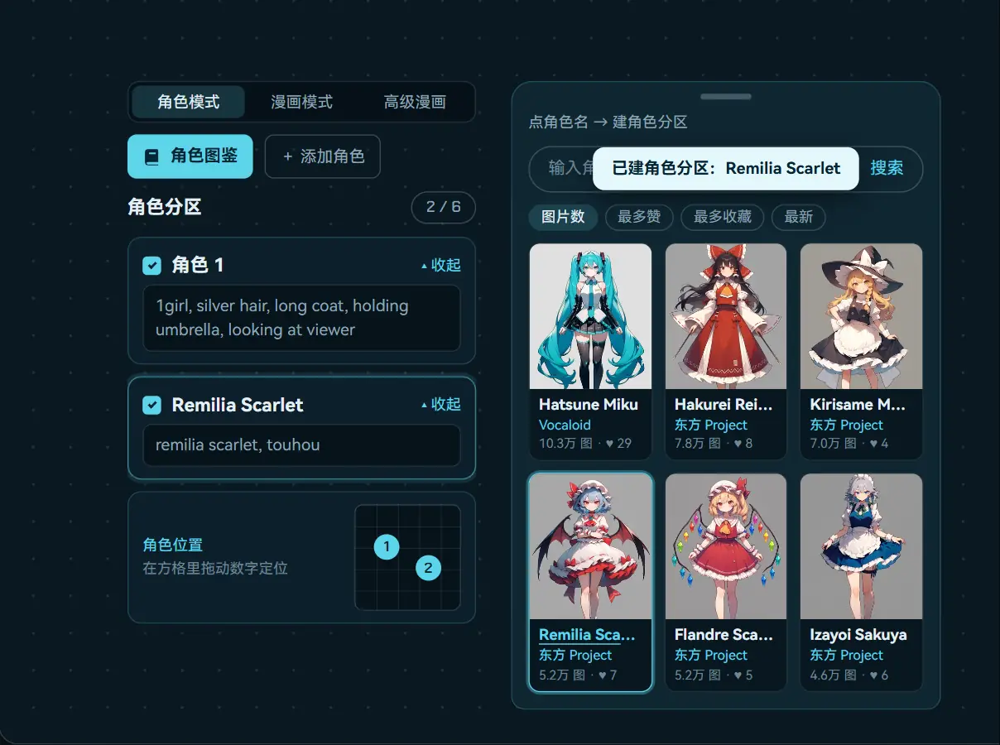
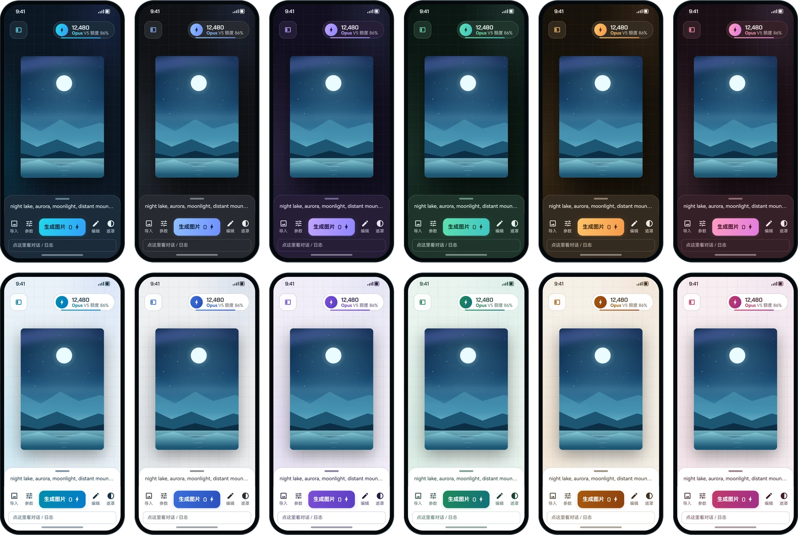

<h1 align="center">
  &nbsp;NAI Studio
</h1>

<p align="center">
  <b>NovelAI 原生客户端，电脑和手机用同一套界面。</b><br>
  易用、便捷、快速：文生图、局部重绘、无限画布、漫画分镜、中英词库，都在一个画面里完成。
</p>

<p align="center">
  <a href="https://github.com/ka114n/NAI-Studio/releases/latest"></a>
  
  
  
  <a href="LICENSE"></a>
</p>

<p align="center">
  <a href="https://github.com/ka114n/NAI-Studio/releases/latest">下载</a> ·
  <a href="https://naistudio.art">官网</a> ·
  <a href="#30-新变化">3.0 新变化</a> ·
  <a href="#功能">功能</a> ·
  <a href="#下载与安装">安装</a> ·
  <a href="#构建">构建</a>
</p>

<p align="center">
  
</p>

> 本项目独立维护，并非 NovelAI 官方产品，与 Anlatan 没有关联。需要自备 NovelAI 账号的 Persistent API Token，或第三方网关（如 NAI Gate）的地址和 API Key。

## 3.0 新变化

- **中英词库**：可选下载 330,745 条 Danbooru 中英词条（约 38 MB），支持模糊搜索、增补、修改和删除；翻译先查词库，查不到再交给百度或 LLM。
- **提示词卡片**：提示词按 tag 显示成中英对照卡片，点卡片左右半边调权重，长按拖动排序，拖进垃圾桶删除。
- **角色搜索**：角色分区下方直接搜中文名或英文 tag，点候选就新建并展开一个角色分区。
- **电脑本地反推、RTX 放大**：电脑可以用本地 PixAI Tagger 反推、用 NVIDIA RTX 做 2× 放大；手机通过「电脑配对」调用电脑的这两项能力。
- **电脑端工具侧栏**：词典、图鉴、法典、元数据、反推收进生图页右侧可收起的侧栏；支持 Windows 原生文件选择和拖入图片。
- 移除 Google 翻译，原设置自动迁移到百度或 LLM。

完整更新说明见 [3.0.0 更新说明](docs/releases/3.0.0.md)。

## 功能

### 框一下，画面就长出来 · 无限画布

在已有画面旁边放一个生成框，点「拓展生成」，新内容接着原图往外长。生成框可选 1024×1024、832×1216、1216×832 三种免费档尺寸；空白区域自动生成遮罩，结果软边回贴到原画面，支持撤销重做。

<p align="center"></p>

### 一格一格写，一整页生成 · 漫画模式

每一格单独写提示词，标注角色、场景、台词或道具；10 种版式加「按数量自动」，可选阅读顺序（右→左或左→右），整页风格词统一管理。也可以只写剧情，让 AI 拆成分镜；剧情很长时用「狂暴模式」自动分页，一页一张排队生成。

<p align="center"></p>

### 点一下角色，分区就建好 · 角色模式

打开角色图鉴点角色名，或在角色搜索里点候选，就自动新建一个填好提示词的角色分区。每个角色有自己的正面和负面提示词，在 5×5 方格里定位，也可以交给 AI 决定位置。V5 最多 32 个分区，V4 / V4.5 最多 6 个。

<p align="center"></p>

### 换个颜色，更合心意 · 配色与语言

手机版内置 冰川、石墨、暮紫、松林、琥珀、樱粉 6 套配色，每套分深色和浅色；电脑版有经典画廊、蓝白、紫罗兰、林绿等配色和毛玻璃风格，可换背景图。两端都能自己调色。界面支持简体中文和英文。

<p align="center"></p>

### 全部功能

没有特别注明的功能，电脑版和手机版都有。

**生成**

| 功能 | 说明 |
| --- | --- |
| 文生图 | NAI V5、V4.5、V4（Full / Curated）以及 V3、V3 Furry；7 种采样器、3 种噪声调度，常用尺寸预设或自定义尺寸；步数、CFG、种子、批量张数可调。生成按钮上预估消耗的 Anlas，生成中继续点会排队。 |
| 图生图 | 用当前图或刚生成的图作底图，可调强度和附加噪声。 |
| 局部重绘 | 直接在画面上涂遮罩，可调遮罩扩张、软边回贴、边缘保护；聚焦重绘只重画框内区域。 |
| 导演台 | 移除背景、清理杂物、提取线稿、转换草图、自动上色、修改表情。 |
| 画布编辑器 | 画笔、橡皮、油漆桶、选择、套索、吸管、模糊、图章，HSV 调色，调整画布尺寸；改完直接作为图生图底图。 |
| 2× 放大 | NovelAI 官方放大，或电脑用 NVIDIA RTX 本地放大（不消耗 Anlas）；手机经电脑配对使用 RTX；可设为生图后自动放大。 |

**提示词与词库**

| 功能 | 说明 |
| --- | --- |
| 提示词面板 | 风格、正面、负面三栏，可分别锁定；撤销重做、历史提示词、风格预设。 |
| 中英对照卡片 | 每个 tag 一张卡片，点左右半边调权重，拖动排序，拖进垃圾桶删除。 |
| 翻译与优化 | 翻译先查本地词库，查不到再用百度翻译或 LLM；LLM 也可以优化提示词。 |
| 词典 | 可选下载的 330,745 条中英词库，模糊搜索，词条可增补、修改、删除，支持批量导入。 |
| 角色图鉴 | 在线浏览 AnimaDex 角色，按角色或作品搜索、排序，点名字新建角色分区。 |
| 所长法典 | 在线查询 NovelAI V5 画师风格词条，支持多词组合、排除词搜索，一键插入提示词。 |
| 元数据 | 读取 NovelAI、WebUI、ComfyUI 图片里的生成参数（含 NovelAI 隐写），导入提示词或复用参数。 |
| 反推提示词 | 用支持识图的 LLM 在线反推（标签、自然语言或混合）；电脑还能用本地 PixAI Tagger 反推，手机经电脑配对调用。 |

**图库与统计**

| 功能 | 说明 |
| --- | --- |
| 图库 | 搜索提示词，按时间或随机排列；原图和它的 2× 放大图合成一格显示。可查看参数、复用参数、重命名、作为图生图底图、批量删除。 |
| 导出与保存 | 电脑可另存为、打开所在文件夹；手机可多选导出到系统文件夹，可选是否同时存入系统相册。可选择是否在图片里保留元数据。 |
| 用量统计 | 像 GitHub 贡献图一样按月查看每天出图张数、消耗点数，只保存在本机。 |
| 余额显示 | 显示订阅档位、Anlas 余额和 V5 免费额度；使用第三方 Key 时显示今日 V5 和本月 Anlas 剩余。 |
| 桌面小组件（仅手机） | 2×1 余额条，或 3×2 余额加统计日历，不打开 App 也能看到。 |

**连接、备份与更新**

| 功能 | 说明 |
| --- | --- |
| 两种接入方式 | 填 NovelAI 的 Persistent API Token 直连官方，或填第三方网关地址和 API Key，随时切换。 |
| LLM 设置 | 兼容 OpenAI 格式的接口，内置 DeepSeek、OpenAI、Kimi、智谱、通义、SiliconFlow、Gemini 等快捷填写；翻译、优化、分镜、反推可以各用不同模型，规则可自己改。 |
| 电脑配对 | 电脑开启 HTTPS 共享后，手机填地址和配对码，就能用电脑的 GPU 反推和 RTX 放大。 |
| 备份 | 设置和预设导出成备份文件；手机还有密码加密的完整迁移备份，包含图片和 API Key。 |
| 应用内更新 | 自动检查新版本，下载后校验大小和 SHA-256；电脑自动替换并重启，手机交给系统安装。 |
| 快捷键与拖入（仅电脑） | 快捷键可自定义（如 Ctrl+Enter 生图）；图片可直接拖到画布、元数据或反推工具里。 |
| 对话与日志 | 每次 LLM 调用和生成请求都有记录，方便排查。 |

> 本页图片为界面演示画面，配色数值取自 App 主题。

## 下载与安装

在 [Releases](https://github.com/ka114n/NAI-Studio/releases/latest) 下载最新版本。

| 文件 | 说明 |
| --- | --- |
| Windows ZIP | Windows 10 / 11 便携版，已包含 Java 运行环境。解压后打开 `NAI Studio.exe`，保留同目录的 `app` 和 `runtime`。 |
| Android APK | Android 8.0 及以上，正式签名。 |
| Source ZIP | 对应版本的源码快照。 |
| `SHA256SUMS.txt` | 以上文件的 SHA-256 校验值。 |

**升级**

- 1.1.143 及以后的版本可以在「设置 → 关于」里检查更新。1.1.142 及更早版本没有更新器，需要手动下载安装一次。[更新机制说明](docs/UPDATES.md)
- Windows：设置、凭据、历史和图片存放在单独的数据目录，替换程序文件不会丢失。
- Android：直接覆盖安装正式签名版本，不要先卸载。旧测试签名版本（如 1.1.139）不能直接覆盖，请先按 [完整迁移说明](docs/FULL_MIGRATION_BACKUP.md) 导出备份再迁移。

Android 签名证书 SHA-256：
`75:BA:9B:19:44:4A:13:E7:3B:BD:B5:B1:26:1D:D4:81:3A:39:57:90:B5:A2:83:7B:D9:57:18:EA:58:4D:76:69`

**按需下载的组件**

安装包里不含以下内容，用到时才下载，之后使用本机缓存：

| 组件 | 什么时候下载 | 大小 |
| --- | --- | --- |
| 中英主词库 | 首次打开词典或点翻译时，由你选择是否下载 | 约 38 MB（解压后约 79 MB） |
| 本地反推（PixAI Tagger） | 电脑首次使用本地反推；需要 NVIDIA 显卡 | 约 5 GB（模型和运行环境） |
| RTX 放大 | 电脑首次使用 RTX 放大；需要 NVIDIA RTX 显卡，驱动 570.65 或更高 | 数 GB（CUDA 运行环境和 NVIDIA VFX 运行库） |
| 网页内核（CEF） | Windows 版首次启动后在后台准备 | 约 570 MB |

使用电脑配对时，电脑需要保持 NAI Studio 运行，并登录允许 Funnel 的 Tailscale 账号；手机不需要安装 Tailscale。[配对说明](docs/TAGGER_HTTPS_SHARING.md)

## 源码结构

- `desktop/naistudio-desktop`：Windows 平台应用。
- `desktop/naistudio-shared`：桌面界面、状态、模型和服务。
- `phone/naistudio`：Android 应用。
- `phone/naistudio-shared`：手机界面、模型和服务。
- `assets/dictionary`：主词库清单与上游许可。
- `tools`：词库构建等辅助脚本。

两端保留独立源码副本，跨端修改需同步检查。

## 构建

使用 JDK 17，首次构建需要联网下载 Gradle 依赖。

Windows，在 `desktop/naistudio-desktop` 执行：

```powershell
..\gradlew.bat desktopInput --no-daemon
```

`desktopInput` 收集应用和依赖 JAR 到 `build/jpackage-input`。可使用 JDK 的 `jpackage --type app-image` 制作便携版，主类为 `com.kallan.naistudio.desktop.MainKt`。发布时将 `docs/brush-lab*.html` 放入应用的 `app` 目录。

Android，安装 SDK，在 `phone/naistudio/local.properties` 配置 `sdk.dir`，然后在 `phone/naistudio` 执行：

```powershell
.\gradlew.bat :app:assembleLocalRelease --no-daemon
```

Release APK 默认未签名，使用自己的密钥签名。构建会递增版本迭代文件，当前版本系列为 3.0.x。

## 许可与致谢

项目自有代码采用 [MIT](LICENSE)。第三方依赖、数据和素材的条款不由 MIT 覆盖，见 [THIRD_PARTY_NOTICES.md](THIRD_PARTY_NOTICES.md)。

- 中英词库来自 [ffdkj/ffdkj-Danbooru_Tag-Chinese-English-Translation-Table](https://github.com/ffdkj/ffdkj-Danbooru_Tag-Chinese-English-Translation-Table)（MIT），单独发布在 [NAI-Studio-dictionary](https://github.com/ka114n/NAI-Studio-dictionary)。
- 所长法典数据在线读取自 [AgIzT/NovelAI-Tag](https://github.com/AgIzT/NovelAI-Tag)，角色图鉴在线读取自 [AnimaDex](https://animadex.net)，均未打包进应用。
- 电脑 HTTPS 共享使用 NanoHTTPD（BSD-3-Clause），许可见 [docs/third-party](docs/third-party/NanoHTTPD-LICENSE.txt)。
